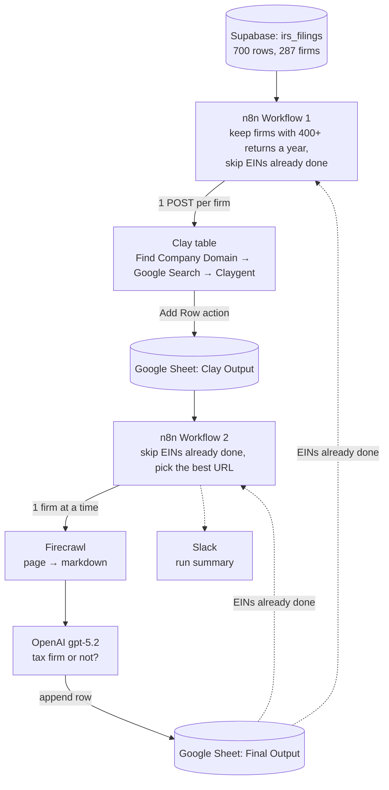

# IRS Tax Firm Classification

Takes firms that filed tax returns with the IRS and checks whether each one is actually a tax firm. The goal is a clean list of tax firms to sell to.

**Live data**

- [Final Output sheet](https://docs.google.com/spreadsheets/d/1l8W1SYddrX2J2qQ_rDv1W6HlkVKAlrsb9oNi3ZPdQNI/edit?gid=0#gid=0): the AI's verdict on every firm
- [Clay Output sheet](https://docs.google.com/spreadsheets/d/1bHruYu5TiWrYruBZITFwb3Hduz6np1-HIf9eMqZfgOA/edit?gid=0#gid=0): the websites Clay found

**Built with:** n8n, Supabase (Postgres), Clay, Firecrawl, OpenAI, Google Sheets, Slack

---

## Part 1: How it works, in plain English

### Why this exists

The goal is to sell to tax firms. The IRS e-file data lists every firm that files returns electronically: its EIN (federal tax ID), name, city, state and how many returns it filed each year.

Filing a lot of returns usually means "tax firm," but not always. In the demo run, one high-volume filer turned out to be a youth nonprofit, and another firm's website had expired. The IRS data also has no websites, so there's nothing in it to check against.

So the pipeline answers one question for every firm: **is this actually a tax firm?**

### The flow

Picture an assembly line. Each firm moves down the line one station at a time, and each station adds something to the firm's row.

| Step | Station | What happens | What it adds |
|---|---|---|---|
| 1 | **Supabase** (the IRS data) | Keeps firms that filed 400+ returns a year on average over the last two years | A short list (33 of 287 firms in the demo) |
| 2 | **n8n, Workflow 1** | Skips firms already in the Final Output sheet and sends the rest to Clay | Only new firms move on |
| 3 | **Clay** | Finds the firm's own website ([how](#what-the-clay-table-does)) | A website |
| 4 | **Firecrawl**, in Workflow 2 | Opens the website and copies its main text | The page's text |
| 5 | **OpenAI** | Reads the name, location, filing count and page text, then decides | Tax firm yes/no, confidence, firm type, services, a short reason |
| 6 | **Google Sheets** | Saves the verdict | A finished row in the Final Output sheet |

You run Workflow 1, wait for Clay to finish, then run Workflow 2.

### Example: one firm, start to finish

*Made-up firm, real steps.*

1. **Supabase:** Main Street Tax Service in Dayton, OH averaged 912 returns a year. That's over 400, so it's kept.
2. **Workflow 1:** its EIN isn't in the Final Output sheet yet, so it's new. n8n sends it to Clay.
3. **Clay:** the quick domain lookup returns a Yelp page. Clay Googles the firm, and its AI agent picks `mainstreettax.com` out of the results. Clay adds the row to the Clay Output sheet.
4. **Firecrawl:** reads `mainstreettax.com`: "Individual and small-business tax returns. IRS e-file. Bookkeeping."
5. **OpenAI:** `is_tax_firm: true`, `confidence: high`, `firm_type: tax_prep`, `services_detected: tax preparation, e-file, bookkeeping`.
6. **Google Sheets:** the verdict becomes a new row in the Final Output sheet. On the next run, step 2 sees the EIN and skips this firm.

### What the Clay table does

Clay works like a spreadsheet where each column can look something up online. Every firm n8n sends becomes a new row, and the columns fill in left to right on their own:

1. **Firm details arrive:** EIN, legal name, DBA name, city, state and average returns, straight from n8n.
2. **Find Company Domain:** Clay's built-in lookup guesses the website from the firm's name. It often lands on a listing page (Yelp, MapQuest, LinkedIn) instead of the firm's own site.
3. **Google Search:** Clay Googles the firm and keeps the top results (a title, link and snippet for each).
4. **Claygent (Clay's AI agent):** reads those results and picks the firm's own website. It skips Yelp, MapQuest, Yellow Pages, BBB, Facebook, LinkedIn and Manta, and returns the domain, a link, how sure it is and why.
5. **Add Row to Google Sheets:** copies the finished row into the [Clay Output sheet](https://docs.google.com/spreadsheets/d/1bHruYu5TiWrYruBZITFwb3Hduz6np1-HIf9eMqZfgOA/edit?gid=0#gid=0), where Workflow 2 picks it up.

Why a Google Sheet in the middle? Clay has no API for reading rows back out, so the sheet is the hand-off point.

Every column's settings, plus how to rebuild the table: [`clay/clay_table_config.md`](clay/clay_table_config.md).

### What comes out

The [Final Output sheet](https://docs.google.com/spreadsheets/d/1l8W1SYddrX2J2qQ_rDv1W6HlkVKAlrsb9oNi3ZPdQNI/edit?gid=0#gid=0) has one row per firm:

| Column | What it means |
|---|---|
| `ein` | The firm's ID in the IRS data |
| `legal_name` | Legal name on the IRS record (often the owner's name) |
| `dba_name` | The name the firm does business as |
| `website_scraped` | The website the AI read |
| `is_tax_firm` | TRUE = tax firm, FALSE = not |
| `confidence` | high, medium or low |
| `firm_type` | `cpa`, `ea` (enrolled agent), `tax_prep`, `bookkeeping`, `financial_services`, `unrelated` or `unknown` |
| `services_detected` | Services named on the website |
| `reasoning` | The AI's one- or two-sentence explanation |

**Demo run:** 33 firms in. **29 are tax firms** (15 tax prep shops, 11 CPA firms, 3 enrolled agents) and **4 are not** (3 unrelated, 1 general financial services). 22 verdicts are high confidence and 11 are medium.

---

## Part 2: Technical details

### Architecture



### What's in this repo

| Path | What it is |
|---|---|
| `README.md` | This file |
| [`HANDOFF.md`](HANDOFF.md) | The original handoff doc: every node, config and gotcha, plus a starter prompt for continuing in a new Claude chat |
| `workflows/workflow1_icp_filter_clay_enrichment.json` | n8n export of Workflow 1, named "ICP Filter & Clay Enrichment Final" in n8n |
| `workflows/workflow2_scrape_classify.json` | n8n export of Workflow 2, named "Find Companies → Scrape → AI Classify → Google Sheets" in n8n |
| [`clay/clay_table_config.md`](clay/clay_table_config.md) | The Clay table's setup, column by column |
| `skill/SKILL.md`, `skill/references/*.md` | A Claude skill (`gtm-pipeline-tools`) with reference notes on Supabase, n8n, Clay, Firecrawl, OpenAI in n8n and Google Sheets in n8n |

### Google Sheets

Both spreadsheets are view-only to anyone with the link.

| Spreadsheet | Tab | Written by | Read by |
|---|---|---|---|
| [IRS Clay Output](https://docs.google.com/spreadsheets/d/1bHruYu5TiWrYruBZITFwb3Hduz6np1-HIf9eMqZfgOA/edit) | [Clay Output: Find](https://docs.google.com/spreadsheets/d/1bHruYu5TiWrYruBZITFwb3Hduz6np1-HIf9eMqZfgOA/edit?gid=0#gid=0) | Clay's Add Row action | Workflow 2 |
| [IRS Project Output](https://docs.google.com/spreadsheets/d/1l8W1SYddrX2J2qQ_rDv1W6HlkVKAlrsb9oNi3ZPdQNI/edit) | [Final Outut: Find](https://docs.google.com/spreadsheets/d/1l8W1SYddrX2J2qQ_rDv1W6HlkVKAlrsb9oNi3ZPdQNI/edit?gid=0#gid=0) | Workflow 2 | Workflows 1 and 2, to skip firms already done |
| IRS Clay Output | [Clay Output: Find + Enrich](https://docs.google.com/spreadsheets/d/1bHruYu5TiWrYruBZITFwb3Hduz6np1-HIf9eMqZfgOA/edit?gid=317449284#gid=317449284) | Clay (experiment) | Pipeline B (inactive) |
| IRS Project Output | [Final Output: Find + Enrich](https://docs.google.com/spreadsheets/d/1l8W1SYddrX2J2qQ_rDv1W6HlkVKAlrsb9oNi3ZPdQNI/edit?gid=214191659#gid=214191659) | Pipeline B (inactive) | Pipeline B |

Columns in the two active tabs:

- **Clay Output: Find:** `ein, legal_name, dba_name, city, state, avg_returns_2yr, domain, company_website`
- **Final Outut: Find:** `ein, legal_name, dba_name, website_scraped, is_tax_firm, confidence, firm_type, services_detected, reasoning`

"Final Outut: Find" is the tab's real name, typo included.

### Data source: Supabase

Table `irs_filings` has one row per firm per filing year. The demo data has 700 rows covering 287 firms over 3 filing years.

| Column | Holds |
|---|---|
| `ein` | Firm ID |
| `legal_name`, `dba_name` | Legal name and business name |
| `city`, `state`, `zip_code` | Location |
| `filing_year` | The year |
| `total_returns`, `accepted_returns`, `rejected_returns` | E-filed return counts for that year |

n8n connects through Supabase's connection pooler, because the direct host runs out of connections during batch runs.

| Setting | Value |
|---|---|
| Host | `aws-0-{region}.pooler.supabase.com` |
| Port | `6543` (not 5432) |
| User | `postgres.{project-ref}` (not `postgres`) |
| Database | `postgres` |
| SSL | On |

The **Query IRS Data** node runs:

```sql
SELECT
  ein, legal_name, dba_name, city, state,
  ROUND(AVG(total_returns)::numeric, 0) AS avg_returns_2yr
FROM irs_filings
WHERE filing_year >= (EXTRACT(YEAR FROM CURRENT_DATE) - 2)
GROUP BY ein, legal_name, dba_name, city, state
HAVING AVG(total_returns) >= {{ $json.min_returns_threshold || 400 }}
ORDER BY avg_returns_2yr DESC
LIMIT 1000;
```

- `{{ ... || 400 }}` is an n8n expression: the cutoff is 400 unless the trigger passes `min_returns_threshold`.
- 400 suits the 287-firm demo (33 firms pass). The production dataset used 1,000 to 10,000.

### Workflow 1: ICP Filter & Clay Enrichment

File: `workflows/workflow1_icp_filter_clay_enrichment.json`

```
Manual Trigger
  → Query IRS Data
  → Read Results Sheet
  → Filter New & Format for Clay
  → Has New Companies?
       true  → Split In Batches (5) → Send to Clay Webhook → Wait 0.5 s → back to Split In Batches
                    done → Done
       false → No New Data
```

| Node | Type | What it does |
|---|---|---|
| Query IRS Data | Postgres, Execute Query | Runs the SQL above |
| Read Results Sheet | Google Sheets, read | Reads every row of Final Outut: Find to learn which EINs are done |
| Filter New & Format for Clay | Code | Builds a set of done EINs, keeps only new firms, outputs the six fields Clay needs |
| Has New Companies? | If | Continues only if `ein` isn't empty |
| Split In Batches | Loop Over Items, batch size 5 | Output 1 (loop) feeds the webhook; output 0 (done) goes to Done |
| Send to Clay Webhook | HTTP Request, POST | One request per firm with a flat JSON body: `ein`, `organization_name` (the legal name), `dba_name`, `city`, `state`, `avg_returns_2yr` |
| Wait | Wait, 0.5 seconds | Pauses between batches so Clay doesn't refuse requests |
| Done, No New Data | No Operation | End points |

The webhook URL in this repo is a placeholder (`YOUR_CLAY_WEBHOOK_URL`). Paste in your table's URL after import.

### Clay table

Sits between the two workflows. Full setup: [`clay/clay_table_config.md`](clay/clay_table_config.md).

| # | Column | Type | Reads | Writes |
|---|---|---|---|---|
| 1 | Webhook source | Source | The POST body from Workflow 1 | `ein`, `organization_name`, `dba_name`, `city`, `state`, `avg_returns_2yr` |
| 2 | Find Company Domain | Enrichment | The firm's name | A domain or URL, often a listing page |
| 3 | Google Search (Perform Search) | Enrichment | A search for the firm | Top results: title, link, snippet |
| 4 | Claygent | AI agent | The Google Search results | JSON: `domain`, `link`, `confidence`, `reason` |
| 5 | Google Sheets → Add Row | Action | Columns 1, 2 and 4 | One row in Clay Output: Find |

How Clay's columns land in the sheet:

| Sheet column | Clay source |
|---|---|
| `ein`, `dba_name`, `city`, `state`, `avg_returns_2yr` | Webhook fields of the same name |
| `legal_name` | Webhook `organization_name` |
| `domain` | Find Company Domain |
| `company_website` | Claygent's `domain` (blank when it found none) |

Settings that matter:

- **Auto-run is on**, so new webhook rows enrich without anyone clicking Run.
- **One firm per webhook call, flat fields.** Sending a `records` array puts the whole array in one cell.
- **No API to read rows.** `GET api.clay.com/v3/sources/{id}/rows` returns 404, so data leaves Clay through the Add Row action.
- **"Only run if" references are inserted with the `/` picker.** Typed references don't link to the column.

### Workflow 2: Scrape & AI Classify

File: `workflows/workflow2_scrape_classify.json`

```
Manual Trigger
  → Read Clay Output
  → Read Results Sheet
  → Select Best Domain
  → If (ein not empty)
       true  → Loop Over Companies (1 at a time)
                  loop → Firecrawl Scrape → AI Classify Tax Firm → Format for Google Sheets
                         → Append to Results Sheet → back to Loop Over Companies
                  done → Slack: "Pipeline complete. Processed N new companies."
       false → Slack: "No new companies to process..."
```

| Node | Type | What it does |
|---|---|---|
| Read Clay Output | Google Sheets, read | Every row of Clay Output: Find |
| Read Results Sheet | Google Sheets, read | Every row of Final Outut: Find |
| Select Best Domain | Code | Drops EINs already in the results, picks the URL to scrape, adds `https://` if missing |
| If | If | Continues only if a firm is left |
| Loop Over Companies | Loop Over Items, batch size 1 | Sends firms through one at a time |
| Firecrawl Scrape | Firecrawl community node, `/scrape` | Fetches the page as markdown. Set to continue on error, so one bad site doesn't stop the run |
| AI Classify Tax Firm | OpenAI node v2.1, Message a Model, `gpt-5.2` | Returns the verdict as JSON |
| Format for Google Sheets | Code | Parses the JSON and merges it with the firm's data |
| Append to Results Sheet | Google Sheets, append, auto-map | Adds the row to Final Outut: Find |
| Send a message, Send a message1 | Slack | Run summaries |

**Which URL gets scraped** (Select Best Domain):

1. `company_website` (Claygent's pick), tagged `ai_validated`.
2. Otherwise `domain` (Clay's default lookup), tagged `default_enrichment`. Even a Yelp or MapQuest link goes through, since the AI can still judge from the name.
3. Otherwise the row is skipped.

The `domain_source` tag isn't written to the sheet. Add it in Format for Google Sheets to keep it.

**Firecrawl:** the node returns no page text unless you add a format by hand after import: Scrape Options → Options → Formats → + Add format → Markdown, then turn on Only Main Content. The text is at `$json.data.markdown`, not `$json.markdown`. Each scrape costs 1 Firecrawl credit.

**OpenAI prompt:**

- *User message:* DBA name, legal name, city and state, average returns, domain, then the first 3,000 characters of the page. With no page text, it says: "No website content available - classify based on company name and filing data only."
- *System message:* a classifier told to decide whether the firm "actively files tax returns for clients." It holds the schema below, field definitions, signals for (tax preparation, IRS, returns, refunds, bookkeeping, CPA, EA, e-file, 1040, W-2, tax planning, payroll), signals against (directory listing, unrelated business, generic content, youth club, financial advisory with no tax prep) and "Return raw JSON only."

```json
{
  "is_tax_firm": true,
  "confidence": "high | medium | low",
  "reasoning": "1-2 sentence explanation",
  "services_detected": ["tax preparation", "bookkeeping"],
  "firm_type": "cpa | ea | tax_prep | bookkeeping | financial_services | unrelated | unknown"
}
```

**Parsing** (Format for Google Sheets). The OpenAI node v2.1 puts the reply at `output[0].content[0].text`:

```js
const content = aiResponse.output?.[0]?.content?.[0]?.text  // OpenAI node v2.1
  || aiResponse.message?.content                              // v1.x
  || aiResponse.content
  || aiResponse.text
  || JSON.stringify(aiResponse);
```

It strips code fences, parses the JSON and joins `services_detected` into one string. If parsing fails, the row is still written, with `is_tax_firm: parse_error` and `confidence: low`.

**Pipeline B (inactive).** The Workflow 2 file also holds a second chain with no trigger, from a "Find Companies" experiment. It reads Clay Output: Find + Enrich (companies from Clay's company search, with size, revenue and LinkedIn), skips repeats by `clay_id`, runs the same scrape and classify steps with a 1-second pause, and appends to Final Output: Find + Enrich. It never runs unless a trigger is attached.

### Re-running safely

Both workflows read the Final Output sheet and skip any EIN already in it:

```js
let processedEINs = new Set();
try {
  if (processedItems.length > 0 && processedItems[0].json.ein !== undefined) {
    processedEINs = new Set(
      processedItems.map(item => String(item.json.ein || '')).filter(id => id !== '')
    );
  }
} catch (e) {
  processedEINs = new Set(); // first run: the sheet is empty
}
```

The Read Results Sheet nodes and the dedup Code nodes have **Always Output Data** on. On the first run (empty sheet), or when nothing is new, the If node still runs and takes the "no new companies" branch.

Two limits:

- **Workflow 1 only skips firms already in the Final Output sheet.** Running it again before Workflow 2 has finished sends the same firms to Clay again and spends Clay credits twice. The demo's Clay Output tab has every firm twice (66 rows for 33 firms).
- **Neither workflow removes repeats inside one run.** If the Clay Output sheet holds the same new EIN twice, Workflow 2 scrapes and classifies it twice. A "seen" set inside Select Best Domain would fix this.

### Setup after importing into n8n

1. Install the Firecrawl community node (`@mendable/n8n-nodes-firecrawl`) if your instance doesn't have it.
2. Re-select credentials: Postgres on Query IRS Data, Google Sheets OAuth2 on every Sheets node, then Firecrawl, OpenAI and Slack. Credentials don't carry over in exports.
3. Paste your Clay webhook URL into Send to Clay Webhook.
4. In Firecrawl Scrape, add the Markdown format and turn on Only Main Content (see above).
5. Put the headers in row 1 of both sheets before the first run. Appends fail without them, and the names must match exactly (case-sensitive).
6. Point the Sheets nodes at your copies of the spreadsheets.
7. Set up the Clay table per [`clay/clay_table_config.md`](clay/clay_table_config.md) and turn auto-run on.
8. Set your channel in the two Slack nodes.

Run order: Workflow 1, then wait for Clay to fill the Clay Output sheet, then Workflow 2.

### Gotchas

| Tool | Gotcha | Fix |
|---|---|---|
| Supabase | The direct host, port 5432 or plain user `postgres` fails or runs out of connections | Pooler host, port 6543, user `postgres.{project-ref}`, SSL on |
| Clay | An array in the webhook body lands in one cell | One firm per call, flat fields |
| Clay | No API to read rows | Add Row action to Google Sheets |
| Firecrawl | No page text by default | Add the Markdown format by hand |
| Firecrawl | The text isn't at `$json.markdown` | Use `$json.data.markdown` |
| OpenAI node v2.1 | The reply isn't at `message.content` | Read `output[0].content[0].text` |
| n8n loops | Wiring the wrong output processes one item and stops | Output 0 = done, output 1 = loop |
| Google Sheets | Appends fail or land in the wrong columns | Headers in row 1, matching field names exactly |
| SQL | The year filter is relative to today, so on a fixed dataset it drops a year of data every January and returns nothing once all filings are over two years old | Use fixed years, e.g. `filing_year IN (2024, 2025)` |

### Known limits

- **Dead websites can hide real tax firms.** A firm with "Tax Service" in its name and 1,300+ returns a year was marked `unrelated` with high confidence because its domain had expired and showed a domain-sale page. Review FALSE rows whose names mention tax, CPA or accounting.
- **No page text means a weaker call.** Yelp, LinkedIn, Facebook and Cloudflare-protected sites return no text, so the AI decides from the name and filing count alone. Expect lower confidence on those rows.
- **Claygent's pick is a best guess.** Check `website_scraped` when a verdict looks off.
- **One page per firm.** Services listed only on inner pages are missed.
